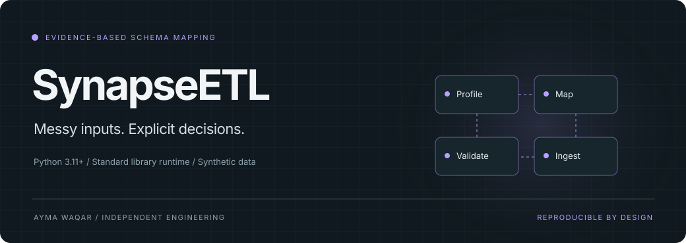
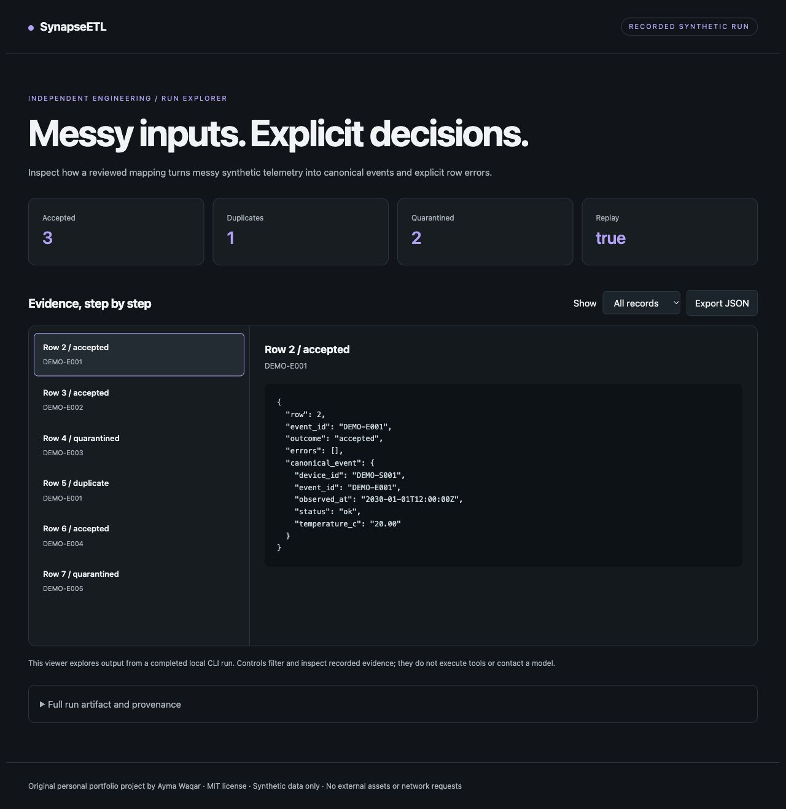
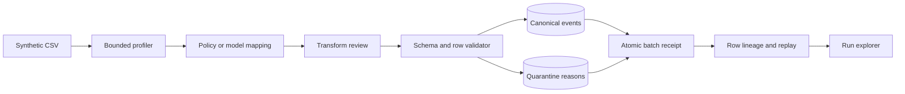

<p align="center"></p>

<p align="center">
<a href="https://github.com/aymaw/synapse-etl/actions/workflows/ci.yml"></a>


<a href="LICENSE"></a>
</p>

<p align="center"><b>A schema-mapping agent with reviewed transforms, quarantine, and row-level lineage.</b></p>
<p align="center"><a href="#try-it-in-a-minute">Quickstart</a> · <a href="docs/architecture.md">Architecture</a> · <a href="docs/tutorial.md">Walkthrough</a> · <a href="docs/demo.html">Run explorer</a> · <a href="docs/scope.md">Scope</a></p>

SynapseETL turns heterogeneous synthetic sensor CSVs into canonical events. A policy or model proposes a field mapping; review binds the exact transforms; deterministic ingestion validates rows, quarantines errors, and records lineage.

## Why this exists

A plausible schema match can silently corrupt data. A temperature field without units should not become a guessed conversion. SynapseETL treats a mapping as a reviewable artifact and every rejected record as an explicit result.

## Try it in a minute

Python 3.11 or later. The demo needs no packages, account, model download, or API key.

```sh
git clone https://github.com/aymaw/synapse-etl.git
cd synapse-etl
python3 -m synapse_etl demo --html .runs/demo.html
python3 -m unittest discover -s tests -v
```

Open `.runs/demo.html` in a browser to inspect the recorded run. JSON is printed
to stdout. The explorer filters records and shows their exact evidence; it does
not execute tools or make network requests. A captured run is in
[`examples/demo.json`](examples/demo.json). Download [`docs/demo.html`](docs/demo.html)
to open the checked-in viewer; GitHub source view does not execute HTML.

```text
input rows: 6
accepted: 3
duplicates: 1
quarantined: 2
68 °F → 20.00 °C
second ingestion: replayed = true
```

The default is a **deterministic synthetic demonstration**. The optional model
path calls your explicitly configured endpoint. Demo results are not live model
measurements. All included records and entities are fictional.

<details>
<summary>See the recorded run explorer</summary>



</details>

## What is implemented

| Capability | Concrete behavior |
| --- | --- |
| **Evidence-first profiling** | Examples, distinct counts, nonempty counts, and ordered header fingerprints. |
| **Bounded mapping language** | Five canonical fields and named transformations; no generated code or eval. |
| **Explicit abstention** | Ambiguous or unknown headers block policy-based approval instead of guessing units. |
| **Transactional ingestion** | Events, quarantine, batch receipt, and row lineage commit together, with content-addressed replay. |

## How it works



The [architecture contract](docs/architecture.md) explains state transitions,
transaction boundaries, failure handling, and the exact guarantees.

## Use it from Python

```python
from synapse_etl.pipeline import Pipeline, propose_mapping, approve_mapping
from pathlib import Path

content = Path("examples/telemetry.csv").read_bytes()
mapping = approve_mapping(propose_mapping(content), "local-reviewer")
pipeline = Pipeline("events.sqlite")
try:
    first = pipeline.ingest(content, mapping)
    assert first["accepted"] == 3
    assert pipeline.ingest(content, mapping)["replayed"]
finally:
    pipeline.close()
```

For an installed command, run `python3 -m pip install .`, then `synapse-etl --help`.
Installation needs setuptools as a build dependency; the runtime has no external
dependencies. Module commands above run directly from the checkout offline.

## Bring a model

The optional JSON transport works with a compatible local or remote chat endpoint.
It sends no data until a model command is called.

```sh
export MODEL_BASE_URL=http://127.0.0.1:11434/v1
export MODEL_NAME=your-installed-model
# For an authenticated endpoint, set MODEL_API_KEY in your environment.
python3 -m synapse_etl propose examples/telemetry.csv --model
```

Use a model already installed at that endpoint. No weights are downloaded or
distributed. Remote endpoints require HTTPS. Redirects are disabled, requests
are bounded to 64 KB, responses to 1 MB, and requests time out after 30 seconds.
Model proposals pass deterministic checks before domain changes. Read the
[transport contract](docs/model-provider.md) and [security notes](SECURITY.md).

## Engineering checks

Mapping integrity, schema drift, ambiguous units, malformed CSV, decimal conversions, conflicting duplicates, quarantine, transaction rollback, and persistent replay.

CI tests, builds and installs the package, checks formatting and lint, compiles
modules, and produces a demo artifact. The configured matrix covers Python
3.11–3.14 on Linux and Python 3.13 on macOS and Windows. A verified green remote
run requires publication and an actual successful Actions run.

```sh
make check
# Optional contributor tooling:
python3 -m pip install '.[dev]'
ruff check .
ruff format --check .
```

Local evidence: [verification record](docs/validation.md).

## Scope

This reference accepts CSV, one synthetic telemetry schema, and a fixed
transform library. It has no distributed processing, connectors, streaming,
schema registry, or automatic repair. Equivalent CSVs with different formatting
create different batches; natural IDs still deduplicate canonical events. Approval
is a local label rather than authenticated authorization. Model commands send
profile samples to your configured endpoint. No live model quality is claimed.

Original personal portfolio work, with no employer affiliation or copied company
implementation. [Provenance](docs/provenance.md) · [MIT license](LICENSE) ·
[Contributing](CONTRIBUTING.md) · [Changelog](CHANGELOG.md)
