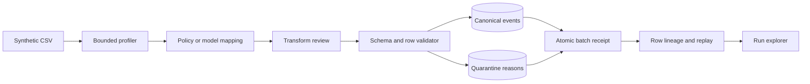

# SynapseETL architecture

## Execution contract

Canonical fields are `event_id`, `device_id`, `observed_at`, `temperature_c`,
and `status`. IDs use `DEMO-` prefixes. Timezones are required and normalized to
UTC. Decimal temperatures must be finite, fall in the synthetic range −80 to
150 °C, and round to two decimal places. Status normalizes to ok/warning/offline.

Mappings need unique existing source columns, every target once, and compatible
named transforms. Review binds header hash, fields, transforms, origin, and
version. Model output cannot add code. CSV bounds: 2 MB, 10,000 rows, 64 columns.

Batch identity hashes source bytes and mapping. Natural IDs deduplicate equal
canonical payloads; conflicting existing IDs are quarantined. Row lineage records
accepted, duplicate, and quarantined outcomes. Quarantine stores field/reason
codes rather than complete raw rows. All batch tables commit atomically.

## Code map

| Location | Responsibility |
| --- | --- |
| `synapse_etl/pipeline.py` | Domain behavior, invariants, and transitions |
| `synapse_etl/cli.py` | Module and installed commands; synthetic demo |
| `synapse_etl/provider.py` | Opt-in bounded JSON model transport |
| `synapse_etl/report.py` | Self-contained run explorer |
| `tests/` | Domain, CLI, and transport regressions |
| `examples/` | Synthetic inputs and captured outputs |

## Authority and trust

The local caller controls files, reviewer labels, and endpoint configuration.
Model output has no special privileges. A hash binds content, not human identity.
The database and Python process are trusted. A hosted deployment would require
identity, access control, secret management, resource limits, monitoring, and
operational review.

## Boundaries

This reference accepts CSV, one synthetic telemetry schema, and a fixed
transform library. It has no distributed processing, connectors, streaming,
schema registry, or automatic repair. Equivalent CSVs with different formatting
create different batches; natural IDs still deduplicate canonical events. Approval
is a local label rather than authenticated authorization. Model commands send
profile samples to your configured endpoint. No live model quality is claimed.
